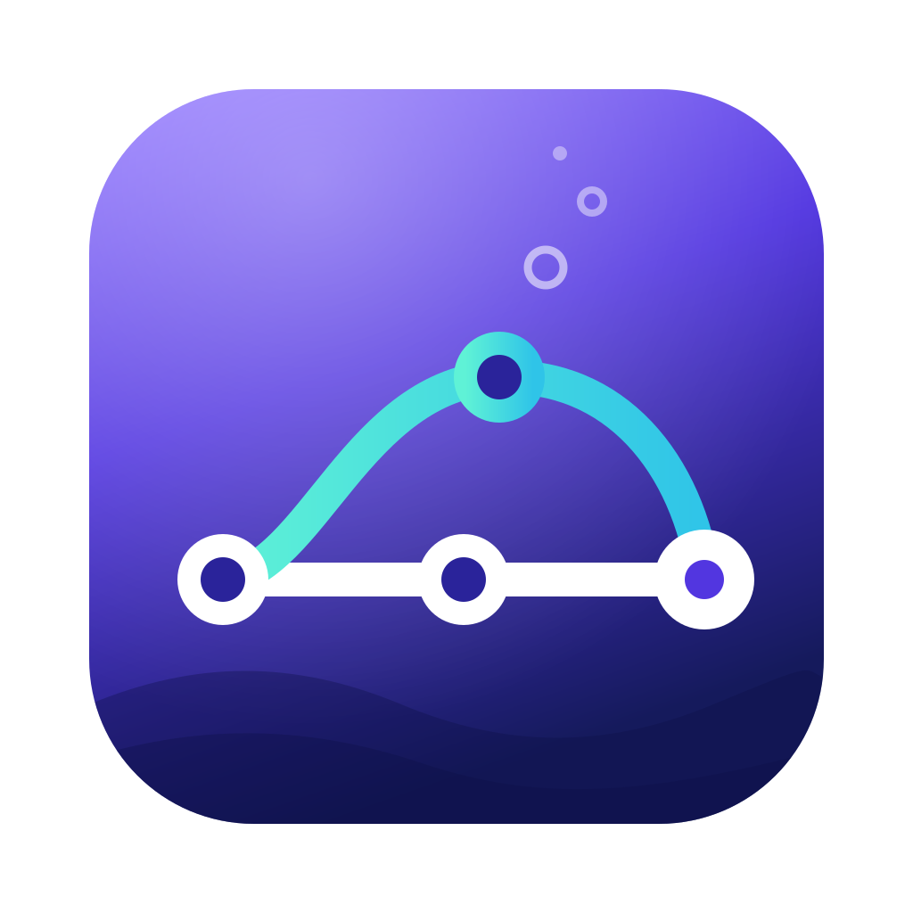

<p align="center"></p>

# git-sea

A read-only Git history viewer for macOS, Linux and Windows, built to make the commit graph easy to understand: where branches go, how they merge, and what the commit tree looks like.

It takes inspiration from GitKraken, with a denser, modern UI (Linear / Raycast style) and an n8n-style node canvas for the graph. It is a personal project and never writes to your repositories.

## Features

- **Node-canvas graph**: commits flow left to right (oldest to HEAD) on a dotted canvas with pan, zoom, pinch and "fit". Nodes show a commit-type icon (Conventional Commits), label, hash and ref badges; edges are colored per lane.
- **Fast on large repos**: the topological walk and lane layout run in Rust and stream to the UI in chunks. On `nodejs/node` (~49k commits) the first rows appear in ~300 ms, and a cached reopen takes ~13 ms.
- **Levels of detail**: full cards up close, tiles at medium zoom, dots and column sampling when zoomed far out. Everything is drawn on Canvas 2D and only visible columns are rendered.
- **Commit details and diffs**: metadata, clickable parents, changed files (with rename detection) and unified or split diffs with Shiki syntax highlighting.
- **Sidebar**: local branches, remotes, tags and stashes, with filtering. Click an entry to jump to its commit.
- **Multiple repos in tabs**, plus a list of recent repositories.
- **Live updates**: a file watcher on `.git` reloads the graph when refs change, keeping your position and selection.
- **On-disk layout cache**, invalidated by an exact fingerprint of the refs.
- **Keyboard-first**: `j`/`k` next/previous commit, `h`/`l` parent/child, `Enter` toggles details, `g h` goes to HEAD, `⌘O` opens a repo, `⌘W` closes a tab, `⌘1`–`⌘9` switches tabs (Ctrl instead of ⌘ on Linux and Windows).
- **Light and dark themes**, following the system setting, with sidebar vibrancy on macOS.
- **English and Italian**: the app follows the system language (Italian if the system is in Italian, English otherwise), and both language and theme can be changed in Settings (`⌘,`).

## Stack

| Layer | Tech |
|---|---|
| Shell | [Tauri 2](https://tauri.app) |
| Git engine | [`gix`](https://github.com/GitoxideLabs/gitoxide) (gitoxide), read-only |
| Backend | Rust: `notify` (watcher), `postcard` (cache), `tauri-specta` (typed bindings), `thiserror`, `tracing` |
| Frontend | React 19, TypeScript, Vite |
| State and data | Zustand, TanStack Query, TanStack Virtual |
| Diff highlighting | Shiki |
| Styling | Plain CSS with tokens on `:root` and CSS Modules |

## Getting started

### Prerequisites

- macOS, Linux or Windows
- [Rust](https://rustup.rs) (stable)
- Node.js and [pnpm](https://pnpm.io)
- macOS: Xcode Command Line Tools
- Linux: the WebKitGTK development packages listed in the [Tauri prerequisites](https://v2.tauri.app/start/prerequisites/#linux) (on Debian/Ubuntu: `libwebkit2gtk-4.1-dev libappindicator3-dev librsvg2-dev patchelf`)
- Windows: the Microsoft C++ Build Tools and WebView2, see the [Tauri prerequisites](https://v2.tauri.app/start/prerequisites/#windows)

### Run

```sh
pnpm install
pnpm tauri dev
```

### Build

```sh
pnpm tauri build
```

### Test

```sh
# Frontend (Vitest)
pnpm test

# Backend (Rust)
cd src-tauri && cargo test
```

The Rust integration tests build fixture repositories from the shell scripts in `src-tauri/tests/fixtures/`.

### Run the CI locally

The workflows can be run with [act](https://nektosact.com/) (`.actrc` picks the Ubuntu images). act runs jobs in Linux containers, so only the Ubuntu variants run locally; the macOS and Windows ones are skipped and run on GitHub.

```sh
act push -W .github/workflows/ci.yml -j check --matrix platform:ubuntu-22.04
```

## Project structure

```
src-tauri/src/
├── commands/   Tauri commands exposed to the frontend
├── session.rs  Per-tab repo session (gix handle, id, load generation)
├── git/        Repository access: commit walk, diff, stashes
├── graph/      Lane assignment algorithm
├── cache/      On-disk layout cache
└── watcher/    .git file watcher

src/
├── app/        Window shell, title bar, tabs
├── features/
│   ├── graph/    Canvas renderer, view math, input handling
│   ├── commits/  Virtualized list view and commit streaming
│   ├── details/  Commit details panel and diff view
│   ├── sidebar/  Branches, remotes, tags, stashes
│   └── repo/     Opening repos, drag & drop, live reload
├── components/ Shared UI primitives
├── lib/        Generated bindings and utilities
└── styles/     Theme tokens and global styles
```

All graph logic lives in Rust: the frontend receives rows that are already laid out (lane, color, edges) and only renders them. TypeScript types for the commands are generated by `tauri-specta` into `src/lib/bindings.ts`.

## Development tools

These pages are for development only and are not part of the app build:

- `bench.html`: graph rendering profiler. Generate data with `cargo run --release --example bench_walk -- <repo> <rev|-> public/dev-data/<file>.json`.
- `panel.html`: details panel with real backend data (`cargo run --example dump_commit -- <repo> "<summary>" public/dev-data/commit.json`).
- `shell.html`: tabs and sidebar with real data.
- `mockup/`: the static HTML/CSS mockup the UI was designed from.

`public/dev-data/` is ignored by git.

## Roadmap

- [x] Commit walk and streaming
- [x] Lane layout
- [x] Node-canvas graph rendering
- [x] Commit details and diffs
- [x] Sidebar and tabs
- [x] Layout cache and watcher
- [ ] Minimap
- [ ] Compressed topological view
- [ ] Horizontal timeline
- [ ] Command palette, search and filters

See [`PLAN.md`](PLAN.md) for the full project plan (in Italian).
